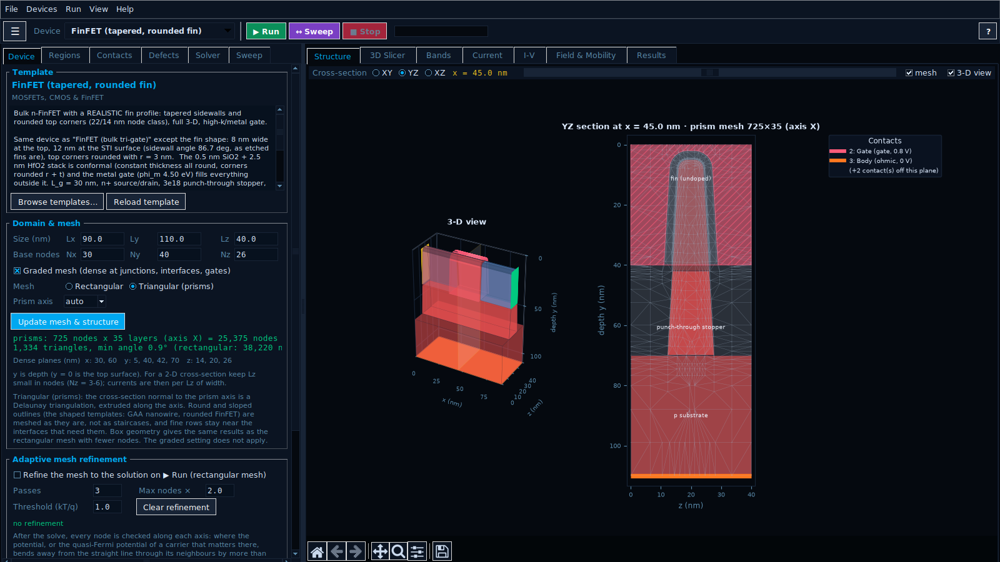
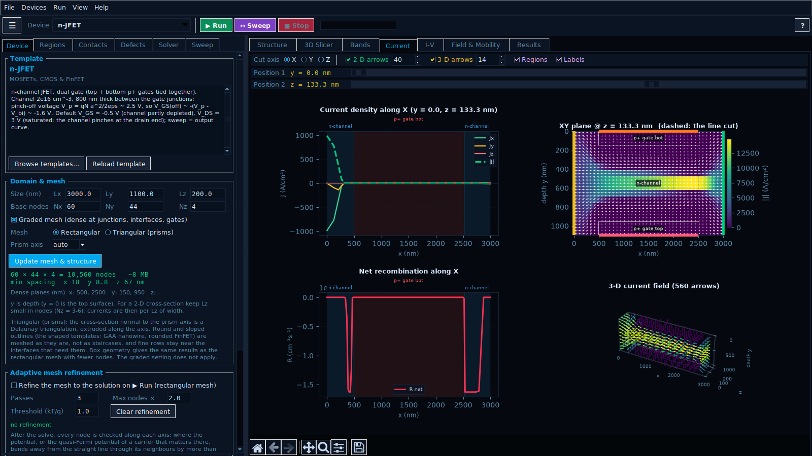
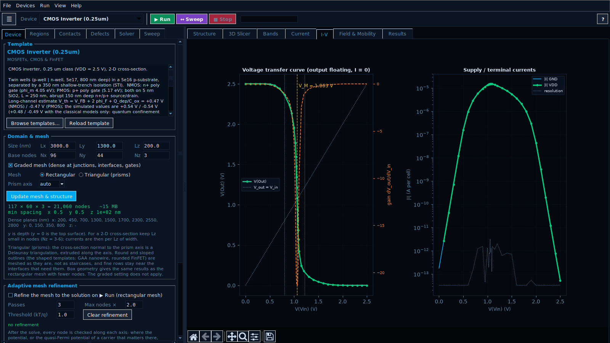
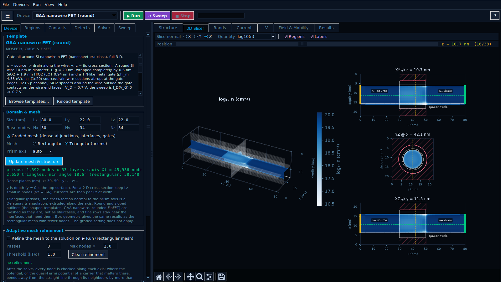
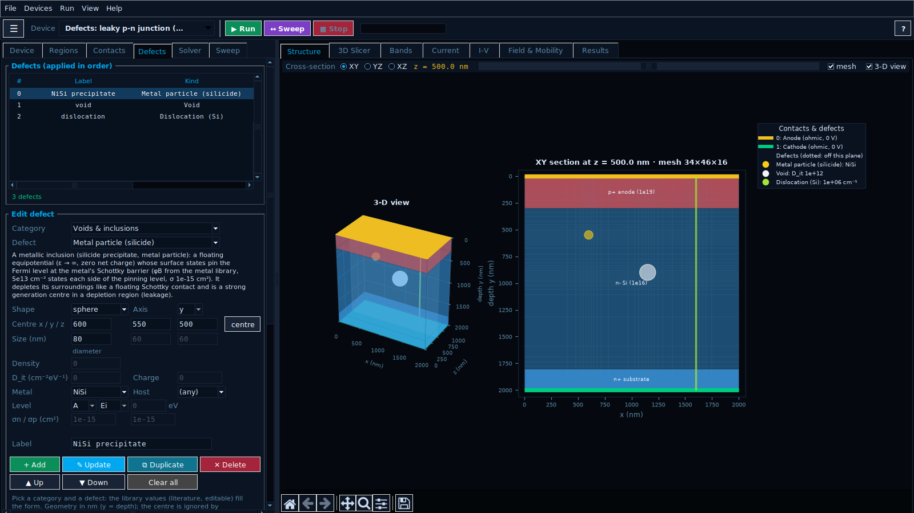

# SemiSim 3D — semiconductor device simulator (v0.1)

A 3-D drift-diffusion simulator for semiconductor devices with a desktop
interface: build a device from blocks of material and doping, solve it, and
look at its bands, fields, current flow and I-V curves. A C core (OpenMP)
does the numerics; the interface is Python/Tk. 47 ready-made devices are
included: diodes, BJTs, MOSFETs, FinFETs, a CMOS inverter, JFETs, GaN HEMTs,
Si and SiC power devices, solar cells, LEDs and photodiodes.

> **v0.1 is the first public version and a test version.** It is still being
> tested and its results can be wrong - see [Status](#status).



| | |
|---|---|
|  |  |
|  |  |

## Install

**Windows (WSL2) and Linux** - in an Ubuntu / WSL terminal:

```bash
sudo apt update && sudo apt install -y git
git clone https://github.com/kotmariusz/Semiconductor_devices_simulator.git
cd Semiconductor_devices_simulator
bash install.sh
```

**macOS** - first `xcode-select --install` and Python from
[python.org](https://www.python.org/downloads/macos/) (or Homebrew), then in
Terminal:

```bash
git clone https://github.com/kotmariusz/Semiconductor_devices_simulator.git
cd Semiconductor_devices_simulator
bash install.sh
```

`install.sh` installs what is missing, builds the solver and runs a short
self-test. Start the program with `semisim3d` (in a new terminal) or
`python3 main.py`; on macOS also by double-clicking `SemiSim3D.command`.
Update with `git pull`. Details: [docs/MANUAL.md](docs/MANUAL.md#install).

## First steps

1. Pick a device in the `Device ▾` menu.
2. `▶ Run` (F5) solves it - look at the Bands, Current and Field tabs.
3. `↔ Sweep` (F6) runs an I-V sweep; `■ Stop` (Esc) stops.
4. Change regions, contacts or defects in the editor and run again.

F1 opens the help. F11 fills the screen (on WSL use it instead of the
maximise button). On a Mac, ⌘R runs and ⌘. stops.

## Status

- The physics is checked against textbook theory (`validate.py`, 167
  checks), not yet against measurements of real devices.
- Results can be wrong, and avalanche breakdown, band-to-band tunnelling,
  light, self-heating and transients are not modelled
  ([Limitations](docs/MANUAL.md#limitations)). Check anything important
  independently.
- `RW:` devices follow the class and ratings of real parts, not their dies.
- macOS support is new and lightly tested.

Problems and ideas:
[Issues](https://github.com/kotmariusz/Semiconductor_devices_simulator/issues)
(attach the saved device and the output of `python3 semibuild.py --check`).

## Documentation

- [docs/MANUAL.md](docs/MANUAL.md) - user manual (also Help, F1)
- [docs/SOURCES.md](docs/SOURCES.md) - all sources: models, parameters, devices, tests, software
- [CHANGELOG.md](CHANGELOG.md) - versions
- [CITATION.cff](CITATION.cff) - how to cite SemiSim 3D

## Licence

[MIT](LICENSE): free to use, copy, change and share for any purpose, as long
as the copyright and licence notice stay with it. No warranty.

## How it was made

Much of the code and documentation was written with the help of an AI
assistant (Claude, by Anthropic). The physics is checked by `validate.py`
against the theory listed in [docs/SOURCES.md](docs/SOURCES.md) - not against
measurements of real devices (see [Status](#status)).

## Citing

If you use SemiSim 3D in your work, please cite it: see [CITATION.cff](CITATION.cff)
or "Cite this repository" on the GitHub page.
